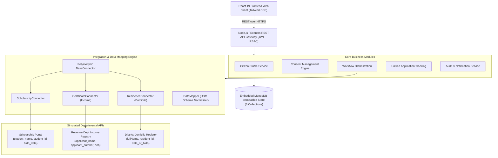

# Unified Government Digital Platform
### System Integration and Interoperability Among Government Digital Platforms Resulting in Fragmented Service Delivery

**B.Tech (VII Semester) Project–1**  
**Department of Computer Science & Engineering, Faculty of Engineering**  
**Medicaps University, Indore – 453331**  
*August – December 2026*  

**Project Authors:**  
- **Aarya Jain** (Enrollment No: `EN23CS301016`)  
- **Aashiya Khan** (Enrollment No: `EN23CS301022`)  
- **Project Guide:** **Prof. Rashmi Vijaywargiya**  

---

## 🏛️ Executive Summary & Problem Scope

Government departments deliver citizen services through isolated online portals developed independently (scholarship portal, revenue income registry, district domicile databases, etc.). Because these systems cannot exchange data, service delivery is fragmented:
- **For Citizens:** Repeated entry of identical demographic data, duplicate document uploads, and disjointed application tracking across separate departmental websites.
- **For Government Officials:** Manual cross-department reconciliation, verification backlogs, and lack of consolidated visibility into citizen eligibility.

The **Unified Government Digital Platform** is an open-standards middleware platform adhering to the **India Enterprise Architecture (IndEA)** framework. Rather than replacing existing departmental software, it establishes a secure integration layer with:
1. **Unified Citizen Profile:** Enter demographic and educational data once; automatically reuse it across all state schemes.
2. **Citizen-Controlled Consent Gate:** Granular, time-bound consent required before any cross-department data exchange occurs (DPDP compliant).
3. **Polymorphic Connector Architecture:** Abstract `BaseConnector` hierarchy with custom data mappers translating disparate database schemas (`student_name` vs `applicant_name` vs `fullName`) into the **Unified Data Model (UDM)**.
4. **Resilient Workflow Orchestration:** Automated multi-department verification pipelines with retry policies, fault isolation (external outages hold applications in `Pending Verification` instead of crashing), and event-driven notifications.
5. **Unified Application Tracking & Auditability:** Single 4-stage tracking timeline for all applications with an append-only audit trail and correlation IDs conforming to W3C PROV.

---

## 📐 System Architecture



---

## 📑 Core Modules & Screen Implementation

All 11 screens defined in the Software Design Specification (SDS Section 3.4.1) are fully implemented:

| # | Screen | Actor | Key Features Implemented |
|---|---|---|---|
| **1** | **Register / Login** | All | JWT authentication, bcrypt password hashing, 1-click Quick Demo logins. |
| **2** | **Citizen Dashboard** | Citizen | KPI counters, linked services strip, unified application table, notification alerts. |
| **3** | **Unified Profile** | Citizen | Common schema editor, "Verified Credentials" badges, live UDM JSON viewer. |
| **4** | **Service Catalogue** | Citizen | Schemes from Higher Education, Revenue, District Administration, and Skills & Employment. |
| **5** | **Application Form** | Citizen | **"Use Information from Saved Profile" 1-click toggle**, auto-filling verified fields. |
| **6** | **Consent Screen** | Citizen | Explicit permission dialog (Requesting Dept, Purpose, Data Categories, 90-day Expiry). |
| **7** | **Consent History** | Citizen | Active permissions overview, past ledger, instant 1-click **Revoke Consent** action. |
| **8** | **Application Timeline** | Citizen | 4-Stage visual stepper (*Submitted* → *Validation* → *Department Verification* → *Sanction*). |
| **9** | **Official Dashboard** | Official | KPI metrics, average processing days (1.8 days), department breakdown chart, sanction queue. |
| **10** | **Audit Log Viewer** | Official / Admin | Filter by Actor, Action, Outcome, with expandable raw JSON inspection. |
| **11** | **Connector Settings** | Admin | Status indicators, live latency ping test, mapping rules editor, and fault-injection simulator. |
| **12** | **Interop Inspector** | Admin / Evaluators | **Live JSON mapping visualizer** showing raw heterogeneous schema transformations in real time! |

---

## ⚡ Quick 1-Click Demo Accounts

The login screen features instant 1-click demo login buttons:

| Role | Name | Email | Password | Primary Functions |
|---|---|---|---|---|
| **Citizen** | Rahul Sharma | `citizen@ugdp.gov.in` | `Password@123` | Profile reuse, application submission, consent grant/revoke, unified timeline tracking. |
| **Department Official** | Priya Deshmukh | `official@ugdp.gov.in` | `Password@123` | Cross-department workload metrics, SLA compliance, application approval/rejection. |
| **System Admin** | Vikram Patil | `admin@ugdp.gov.in` | `Password@123` | Connector health checks, mapping rules inspection, audit logs, and fault injection. |

---

## 🚀 How to Run the Project

### Prerequisites
- **Node.js** v18+ (tested on Node v24)
- **npm** v9+

### Option 1: Run the Production Integrated App (Single Command)
The React client is pre-built into `client/dist`. The Node.js Express server automatically serves both the backend REST APIs and the frontend static build on port 5000:

```bash
cd C:\Users\DELL\.gemini\antigravity\scratch\samanvay-ugds
npm start
```
Open your browser at: **`http://localhost:5000`**

---

### Option 2: Run in Development Mode (Separate Frontend & Backend)

**Terminal 1 (Backend API & Mock Portals):**
```bash
cd C:\Users\DELL\.gemini\antigravity\scratch\samanvay-ugds
npm run server
```
*API Gateway runs on `http://localhost:5000`*

**Terminal 2 (Vite React Client with Hot Reload):**
```bash
cd C:\Users\DELL\.gemini\antigravity\scratch\samanvay-ugds
npm run client
```
*Frontend runs on `http://localhost:3000` with automated proxy to port 5000.*

---

## 🧪 Automated End-to-End Test Suite

Run the automated integration test script to verify all 7 core use cases:
```bash
cd C:\Users\DELL\.gemini\antigravity\scratch\samanvay-ugds
node server/test-server.js
```
**Test Results:**
- `[1/7] Health Check Status: 200 ONLINE`
- `[2/7] Mock Portals Active: [ 'scholarship', 'income', 'residence' ]`
- `[3/7] Demo Citizen Login: SUCCESS Rahul Sharma`
- `[4/7] Unified Profile Retrieved: Rahul Sharma (DOB: 2004-06-15)`
- `[5/7] Available Services: 4 loaded`
- `[6/7] Integration Engine Cross-Verification: Consent Checked & Correlation ID generated`
- `[7/7] Application Submitted & Orchestrated: Multi-stage workflow executed`

---

## 🎬 Live Demonstration Sequence (Step-by-Step)

1. **Scene 1 – Citizen Login & Unified Profile:**
   - Log in as **Citizen (Rahul Sharma)** using the quick button.
   - Open **Unified Profile** to show demographic & academic data stored in the canonical schema.
2. **Scene 2 – Profile Reuse in Application Form:**
   - Navigate to **Service Catalogue** and click **Apply** on *Post-Matric Scholarship Scheme 2026*.
   - Toggle **"Use Saved Profile"** ON to demonstrate 100% automatic pre-filling of personal, address, and college details without re-typing.
3. **Scene 3 – Explicit Consent Gate:**
   - Click **Submit Application**. The **Consent Modal** appears requesting access to Income Certificate, Residence, and Academic records.
   - Click **Approve & Proceed**.
4. **Scene 4 – Interoperability Inspector:**
   - Click the **Interop Inspector** tab in the top navigation.
   - Observe the live **Heterogeneous Schema Normalization Matrix**:
     - Scholarship uses `student_name` & `birth_date` (`DD-MM-YYYY`).
     - Income uses `applicant_name` & `dob` (`YYYY-MM-DD`).
     - Residence uses `fullName` & `date_of_birth` (ISO).
     - The platform automatically normalizes all three into `name` & `date_of_birth`.
   - Click **"Run Live Interoperability Test"** to view raw JSON requests and normalized responses.
5. **Scene 5 – Unified Application Tracking:**
   - Open **My Dashboard** or **Track Timeline**.
   - Review the 4-stage visual stepper (*Submitted* → *Initial Validation* → *Department Verification* → *Decision*), complete with verified income (₹1,80,000) and domicile records.
6. **Scene 6 – Official Command Center & Audit Trail:**
   - Switch role to **Official** or **Admin** via the top navbar pill.
   - Review department workload charts, average processing time (1.8 days), and approve pending applications with statutory remarks.
   - Inspect the **Audit Logs** viewer to review the tamper-evident ledger with unique correlation IDs.
7. **Scene 7 – Fault Injection & Resilience:**
   - In **Interop Inspector** or **Connectors & Health**, toggle the Income Portal to **"503 Outage"**.
   - Submit a verification or retry an application.
   - Observe that the platform **does not crash**: it gracefully flags the application as `Pending Verification`, sends a delay notification to the citizen, logs the error, and schedules an automated retry!
